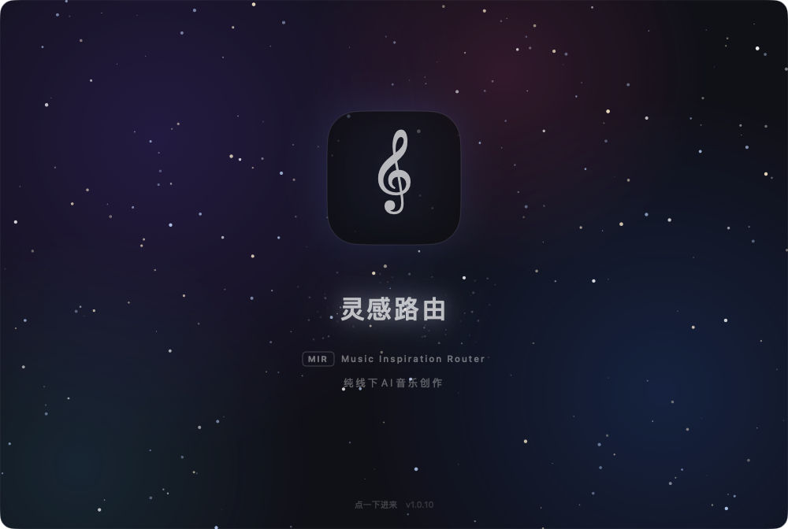
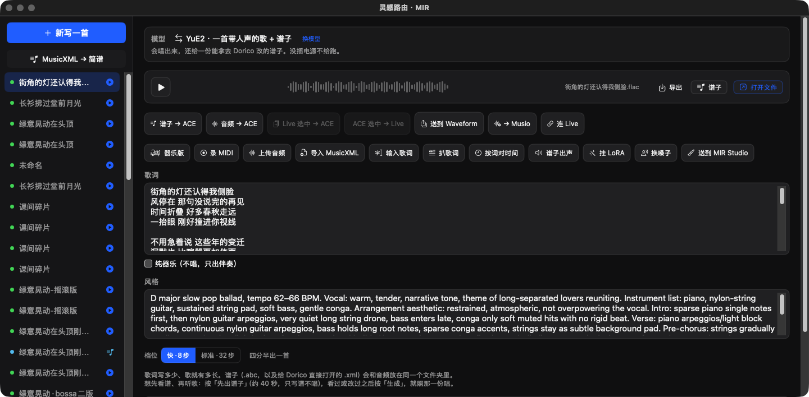
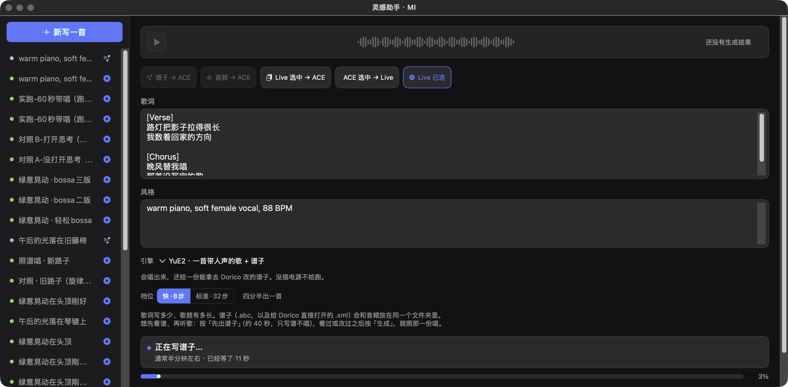
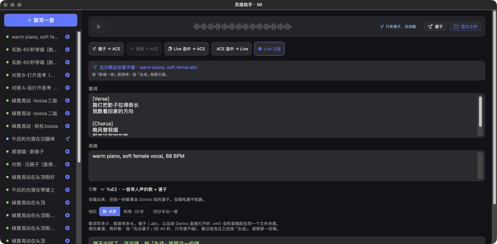
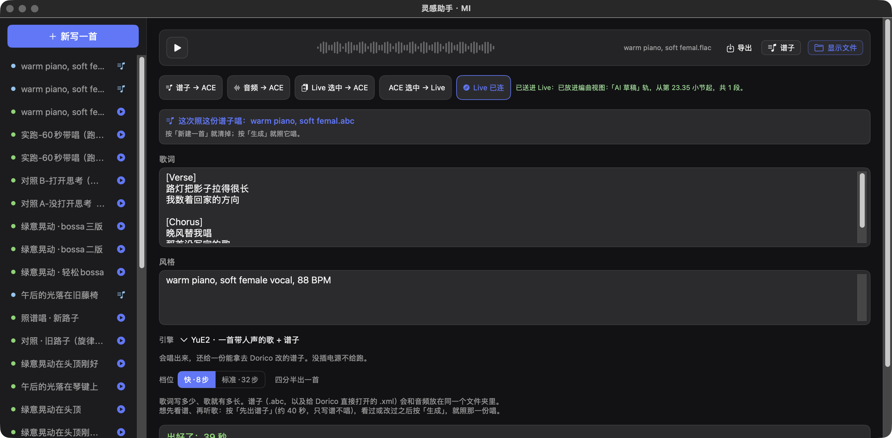
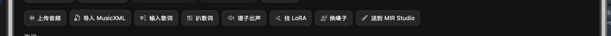
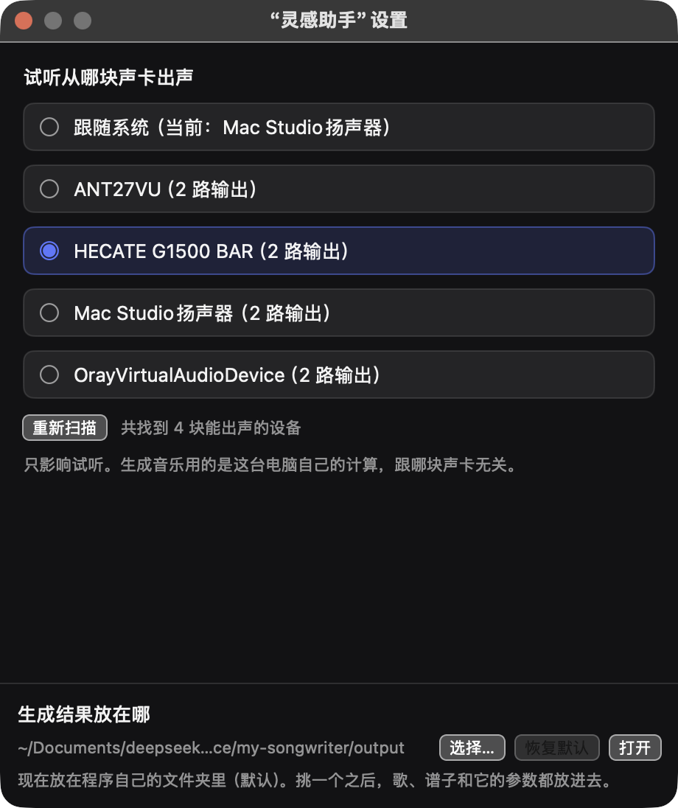
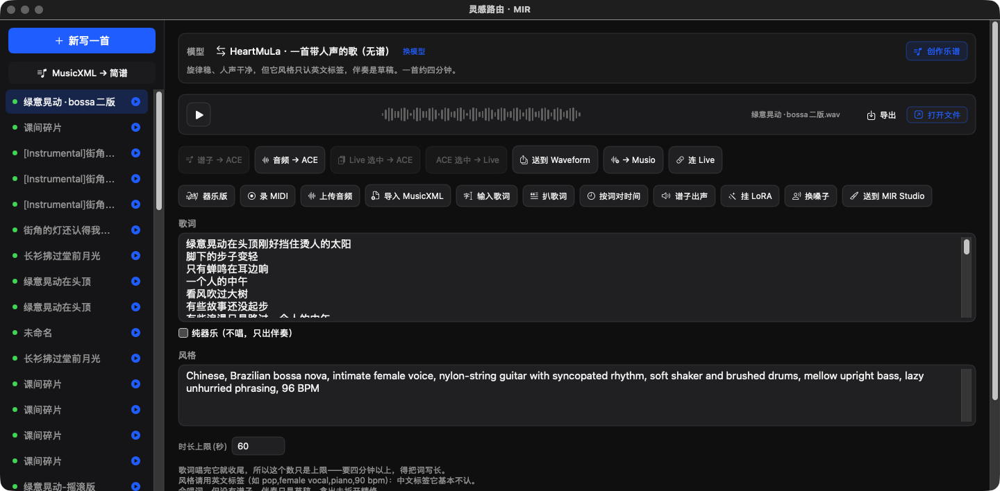

<!-- cover: images/00-封面.png -->

# 灵感路由 使用手册

（MIR · Music Inspiration Router）

写给第一次打开这个软件的人。不用懂编程，也不用联网。

一句话说清它的用处：

> **在自己这台电脑上写歌 —— 填一段风格、点一下「生成」，
> 几分钟就有一首带人声的歌，外加一份能拿进 Dorico 的谱子。
> 只要一段没人唱的音乐也行：换一台模型，几秒钟就出。
> 全套都在本机跑：不出网，也不花一分钱。**

它现在不只是写歌的：生成的音频和谱子能一键送进 **ACE Studio**，ACE 里唱好的、**Ableton Live** 里选中的，也能互相递。名字里的「路由」（MIR）说的就是这一层 —— 它在中间递东西，成品在 Live 和 ACE 里做。

---

## 一、开始之前

**什么都不用准备。**

不用登录、不用买额度、不用连网。它整套都装在这台电脑里（模型十来 G），打开就能用。

两件要留意：

- **插着电源。** 唱歌的那台引擎（YuE2）跑起来吃电，拔了电池它会不肯跑。
- **生成时它要吃不少内存和显卡。** 所以按下「生成」之前，把 ACE Studio、Dorico这些大工程**存一下**。跑完就全还回来。

---

## 二、第一次打开：一屏两块

**先会看到一张「星空」**：一片深蓝紫的星海里浮着黑色的方块、方块里是那支白色高音谱号（就是程序图标的样子），底下写着「纯线下 AI 音乐创作」。**约两秒它自己淡出** —— 想快点进就点它一下，按 Esc 也行。

左边是**你写过的曲子**（第一次打开时是空的）。右边是**这一首的参数**。

左上角那个蓝色按钮是「新写一首」—— 点它，右边的表单清空，准备写新的。

等你生成过几首之后，左边就会长出一列：

最上面那条「**模型**」决定这一首用哪台机器写 —— 点那个带左右箭头的彩色框，
或者点它旁边的「换模型」，就能换。

**点左边任意一条，右边的参数就换成那一首的**，可以照着改一版再生成。

条目的名字：你给过名字就用你那个；没给过的，用歌词第一句。

---

## 三、右边这些格子，填什么

### 模型

就一格，决定这一首用哪台机器写。下拉里三个：

**YuE2 · 一首带人声的歌 + 谱子**

它出一首**会唱的歌**，还会顺手给你一份谱子（`.abc`，以及给 Dorico 直接打开的 `.xml`）。
慢：快档约四分半，标准档约十分钟。

**Stable Audio Medium · 配乐 / 氛围，不唱词**

它只出**纯音乐**：配乐、氛围、效果音。快 —— 一段三十秒的配乐几秒钟就出来，
最长能做 **6 分 20 秒**。但它**不会唱词，也没有谱子**；切到它的时候，
歌词框会自己收起来（不是坏了，是这台没有「唱」这件事），下面多出一格「时长（秒）」。

**HeartMuLa · 一首带人声的歌（无谱）**

它也给词就唱，走的是另一条路：**旋律稳、人声特别干净**。适合当"人声草稿"——
出来之后拖进 DAW 或 ACE，把人声和伴奏拆开，再自己动手术。它**不出谱子**，
**伴奏也只是草稿**（不够"打"是它的老毛病，但不至于惨不忍睹）。

三分钟的歌约四分半出来，等的时候机器不卡，可以干别的。

两个要注意：

- **风格必须写英文标签**（如 `pop,female vocal,piano,90 bpm`）。中文标签它基本不认，
  这是模型本身的毛病。标签也别堆一排，**三五个词就够**——堆多了它反而会唱跑调。
- 下面那格「时长上限」**只是上限**：词唱完它就收尾。想要四分钟以上，得把词写长。

它也**不认爵士**这类老派编制：写 big band 出来会像带响指的 R&B。这是它的代偿，
不是坏了——要风格精确，那是 ACE Studio 的活儿。

> ⚠️ **伴奏里的和声别当真。** 2026-11-10 他自己跑了两轮，听到伴奏里有**错音、
> 不协和的和声**。它的伴奏不是"能和声参考"的水平 —— 旋律和人声拿走，
> 和声与配器都是你的事；这正好也是它最该被用成的样子。

一句话记法：**要唱、要谱子 → YuE2；要一段没人唱的音乐 → Stable Audio；
只要人声和旋律的草稿、不在乎谱子 → HeartMuLa。**

> 它跟「器乐版」（给器乐定旋律）不是一回事：器乐版照你 MIDI 里的音一个一个奏，
> 而 Stable Audio 只照你写的**感觉**（比如「雨夜的小巷」）自己编旋律，
> **不能指定音**。所以在 Stable Audio 那一档按「器乐版」，程序会自动切回 YuE2。

第一次用 Stable Audio、又写的是中文描述，会**先慢一下** —— 它在把中文翻成英文。
第二趟起就快了。

> 原来还有一台叫 ACE-Step 的引擎，2026-10-16 拆掉了 —— 它只能出一分钟以内的一段、
> 生成时很吃内存，而这活 ACE Studio 干得更好。想装回来也有办法（见项目文档），
> 但平常你用不上。

### 歌词

YuE2 靠歌词认识这首歌：**词多长，歌就有多长。**

想唱就把词粘进去，中文英文都行。建议照它的习惯**分段**：`[Verse]`、`[Chorus]`、`[Bridge]` 这类方括号标记，一个标记带一段。它认这个格式，而且**不改你的词**。一个标记都不写也能跑，保险起见还是分一下。

**想只要器乐**：勾上歌词框下面那个「**纯器乐（不唱，只出伴奏）**」。

勾上之后歌词框会锁住，这一趟压根不带词。它不是把词清空就完事 —— 会**先单独把谱子出出来**（约 40 秒），把人声轨清干净、旋律整条搬到器乐轨，再照这份谱合成。所以比正常一趟多等半分钟。

⚠️ **只能做到"人声轨干净"**：模型有时候还是会在乐器轨里哼出人声（一句像英语又不是英语的东西，还会重复）。这是模型内部的行为，界面按不住 —— 官方文档也明说这条路「没有保证零人声的硬开关」。

### 风格

这一格最要紧 —— **它决定这首曲子长什么样。**

写得越具体越好：什么编制、什么情绪、快还是慢、干还是湿。比如：

> 温暖的中国风室内乐。古筝与弦乐对话，旋律缓慢流动，大量留白，
> 亲密而干净，像午后窗边的独奏。

### 档位

**快·8 步** ／ **标准·32 步**。

快档一两分钟、声音粗一点；标准档更细，但慢得多。**快档就够用** ——先拿它试想法，觉得值得再上标准档。

### 歌词框上面那张卡（导入谱子之后才有）

它是「这次照的是哪一份谱子」的凭据，见第五节。

---

## 四、按下「生成」

按下去之后，进度条开始走。条上面那张**说明卡**会一路告诉你三件事：

- **大字**：现在在哪一步（「正在启动作曲的 AI…」「正在照着谱子唱…」）；
- **小字**：这一步大概要多久；
- **末尾那句「已经等了 1 分 20 秒」** —— 这个数字**每秒都在涨**。

最后这条最有用：**进度条半分钟不动的那些时候**，你只要看那个秒数还在涨，就知道它是在干活、不是卡住了。进度条那头还有一颗慢慢呼吸的小白点，也是同一个意思。

大概要等多久（这台机器 M1 Max 实测）：

| 档位 | 多长的歌 | 大约要等 |
|---|---|---|
| 快·8 步 | 主歌加副歌一首（2 分 45 秒） | **三分十一秒**（2026-10-13 实测） |
| 标准·32 步 | 同样长度 | 十分钟上下 |
| **Stable Audio** | 一段 30 秒的配乐 | **几秒钟**；最长的 6 分 20 秒也在一分钟内 |
| **HeartMuLa** | 三分钟的歌 | **四分半上下**（2026-11-10 实测） |

**歌多长由你的词多长决定**，所以"要等多久"跟词的长短一起变 ——上面那个三分十一秒是一次真实记录，不是承诺。

等的时候别同时跑别的重活。中途不想要了，按红色的「停止」——它会收干净，不留半截文件。

### 照谱唱时，它会先替你数一遍字

如果你这次是**照一份谱子唱**（歌词框上面有那张蓝字卡），开跑之前它会先对一下：
**你写的字数**和**谱子上的音位**是不是一样多。

- 一样多：不打扰你。
- 不一样：进度下面那行小字里会提醒一句，跑完的结果条上也留着。
  **它照唱，不拦你** —— 词少了，后面会错位；词多了，多出来的字唱不进去。
  想改，把词补齐（或删掉多的字），再跑一遍。

### 想先看谱、再听歌：按「先出谱子」

YuE2 那台可以**先出乐谱、再出歌**。所以「生成」旁边还有一个**「先出谱子」**：

- 按它，**约一分钟**只出谱子：一份 `.abc`，外带给 Dorico 直接打开的 `.xml`（**两份一起给，不用自己转格式**），**先不唱**。
- 谱子出来之后，它会**自己顶到「这次照它唱」的位置** —— 歌词框上面那张蓝字卡会写着是哪一份。这时按「生成」，出来的歌就**照你手上这份谱子唱**，不再自己另写一份。
- 只出了谱子、还没唱的那一条，在左边是**青蓝色**的、右边带个小谱号 ——跟"歌已经出来"的绿色一眼分得开。
- 谱子想改：进 Dorico 改完，用**文件 → 导入谱子…**，选「按这份谱子重唱」；或者干脆再按一次「先出谱子」，换一份新的。

> **直接按「生成」时，谱子和歌是一起出来的**（放在同一个文件夹里）——
> 不先出谱子也有谱子。先出谱子，只是为了**多一次看它、改它的机会**。

---

## 五、生成完了，东西在哪

结果条右边有三个按钮（用 YuE2 生成的那一首）：

- **导出** —— 存成 MP3（320 kbps，体积小、方便分享）或者 WAV（原样无损）
- **谱子** —— 在访达里定位到那一份给 Dorico 打开的 `.xml`
- **显示文件** —— 在访达里**直接定位到这一首**

> 只出了谱子、还没唱的那一条（在左边是青蓝色的）**右边没有「导出」** ——
> 它还没有声音可导，摆出来也是错的。「谱子」和「显示文件」照旧能点。

> 用 **Stable Audio** 出的那一首，右边**没有「谱子」按钮** —— 它本来就不出谱。
> 导出、打开文件照旧。

**一个文件夹里躺着什么**：YuE2 出三份 —— 音频（`.flac`）、谱子（`.abc`）、给 Dorico 的谱子（`.xml`），名字都一样，只差后缀；外加一份 `params.json`，记着当初填的参数，想重做一版照着填就行。

文件夹名是**时间加名字**（例如 `20261013-113118 热血摇滚…`），按名字排序就是按时间排序，最新的那一首一直排在最上面。

底下「生成」按钮右边还有个 **「打开文件夹」**，打开的是全部结果所在的文件夹。

### 谱子上的词从哪来

**你填了词，谱子就带你的词** —— 每个音对哪个字，打开就看得见。

**没填词也能在谱子上看到词**（2026-10-18 加的）：YuE2 唱出来之后，程序用**本机听写**把唱的词抓下来、贴进谱子。谱子头上会写一句「歌词来自听写，仅供参考」。只对**中文**采用（英文会被拆成字母逐个贴，等于拼字）。

> 听写对**慢、清的中文唱**可用；伴奏厚、唱得快时可能一个字都听不出。
> 错字难免 —— 听感对了就行。

### 送去 ACE Studio

播放条下面一排按钮，**送的都是左边列表里选中的这一首**：

- **「谱子 → ACE」** —— 人声进**唱轨**，谱子走 MusicXML 这条路，**歌词和速度一起跟着进去**。到了 ACE 里，那一句唱的就是你谱子上的词；速度、拍号也是你谱子上的那个。
- **「音频 → ACE」** —— 草稿的声音进**音频轨**，你对着它当参考。

**伴奏不送** —— 你自己弹的或写的，比它给的准。分成两个是为你方便：常见的情形是**谱子改过了、声音还是旧的**（或者反过来），那就只补送一样，不用整个重来。

几点说明：

- **哪一样手上没有，那个按钮就是灰的** —— 位置不动，你不会找不到它。
- **ACE 没开着也没关系**：点一下它会**自己把 ACE 打开**再送。ACE 刚启动那几秒还不能干活，所以从点下去到送完可能要等十来秒。
- 送完 **ACE 会自己跳到前面**，按钮旁边那行会告诉你**落了几条轨**。
- 每点一次就**再落一套轨**（ACE 里原来的东西不动）。点多了就撤销一下，或者删掉多的那几条。

### 送去 Ableton Live

同一排还有三样：

- **「连 Live」** —— Live 没开着就替你打开；开着就**自动连上**，按钮变绿写「Live 已连」。两边都开着时它 3 秒内自己亮，不用按。
- **「Live 选中 → ACE」** —— 把 **Live 里选中的那一段**送进 ACE：音频按起止裁成 wav，MIDI 写成 `.mid`。
- **「ACE 选中 → Live」** —— 把 **ACE 里选中的轨**渲染出来，落进 Live 编曲视图的「来自 ACE」轨。

**生成完自动送**（2026-10-17 起）：连着 Live 的时候，每生成完一首，它自己落进 Live 的 **「AI 草稿」轨**；歌词里带 `[Verse]` 这类段落标记、又有谱子的话，会**按段切好**，切出来的小片段叫 `sketch 1`、`sketch 2`…（切点是近似的，所以不写 Intro/Chorus —— 标了段名就等于担保"这里一定对"）。**没连着 Live 就静默不送**，不打扰。

**速度跟着走**：往 Live 送时先量一个速度，**空工程才写工程速度**；工程里已经有东西就只回报、不动你的速度。从 ACE 送回来的音频，读的是 ACE 里那个 BPM。

> ⚠️ **第一次用要设一次**（只设一次）：Live 菜单 → Settings（⌘,）→
> **Link, Tempo & MIDI** → **Control Surface** → 选 **AbletonMySongwriter**。
> 选过之后，Live 以后每次启动都会自己加载它。

> 喂给 Live 的只有音频（切段、循环、分轨都在 Live 里做）；
> 谱子只在往 ACE 送的时候用。

### 把谱子拿出来、改完再送回去

**拿出来**：菜单栏 **文件 → 导出谱子（MusicXML）**（或「导出谱子（abc）」），点一下就存好了 —— 存在 **「文稿 / My Songwriter 谱子」** 这个文件夹里（文件夹的名字没跟着改名，你的旧谱子都还在那儿；访达左边栏点「文稿」就看得见）。想存到别的地方：**按住 Option 键再点这个菜单**，会弹窗让你自己挑。同一首再导一次不会覆盖上一个（会多一个 `-2`），所以你改过的不会被抹掉。

**送回去**：菜单栏 **文件 → 导入谱子…**，选你在 Dorico 里改完导出的那份。它会问你一句要怎么用：

- **按这份谱子重唱 / 照这份谱子写新歌** —— **拿这份谱子当条件**再出一首（音一个不改；歌词位置偶尔错位，**字不会错**，听一下就知道）。
- **只转格式** —— 只把 MusicXML 和 abc 互相转一下，不动生成。

**新开一首的时候也能直接导入**：左边空着（刚按了「新建一首」）也行 ——读到的信息摆在歌词框上面，词进歌词框，你按「生成」它才照这份唱。

导入后那张卡会把读到的念给你听：速度、拍号、调号、和弦数、音符数、歌词字数，以及词去哪儿了（「谱子里的 356 个字已经填进下面的歌词框」）。

> **谱子里读出来的词是别人的原词，一个字都不改** —— 只按音乐的呼吸点分了个行。
> 分句只能靠音乐来猜，个别地方可能断得不是你要的那一句 ——
> 在歌词框里顺手挪两下就行，**字是不会错的**。

### 右击左边那一条

**在左边列表里右击任意一条**，菜单第一项就是「在文件夹中显示」。不用先选中、也不用去上面找按钮 —— **指到哪一条，菜单就是哪一条的**。同一份菜单里还有「试听」和「导出」，都在手边上。

---

## 六、扒歌词：一首歌 → 一份词

**手里有一首歌，网上查不到词** —— 冷门录音、现场版、随口唱的、AI 刚给你唱出来的。这时候用「扒歌词」。

按钮就在「上传音频」旁边：**扒歌词**。

它一口气干两件事，你只按一次：

1. **先把伴奏剥掉**，只留人声（伴奏会把字糊住）；
2. **再认人声里的字**，写成一份 `歌词.txt`，同时**直接填进下边的歌词框**。

认完可以接着改，也可以照这份词重新生成一版 —— 词有了，这就是一首能重填词、重新唱的歌。

**它自己挑耳朵，你不用管**：

| 唱的是 | 它用哪套 |
|---|---|
| 中文、英文、俄语 | Qwen3-ASR（快的那套） |
| 挪威、丹麦、瑞典语、德语、西班牙语…… | CrisperWhisper（逐字那套） |

法语目前两套都不太行，会编；那类有现成文本的作品，还是查原文稳。

**一句实话：它是草稿，不是歌词。**

- 错得最多的是虚词和同音词（`you're` 听成 `your`、啊听成安）；
- 更麻烦的是**它会编** —— 听不清的时候给你一句通顺但不对的话，
  你甚至不知道该改哪儿。所以拿到手**先对一遍原文**，再给人。

速度参考：一首三分钟的歌，拆人声约 40 秒、认字十几秒；九分钟的曲子，两分钟左右。

---

## 七、试听走哪块声卡

右下角那个齿轮（或者按 ⌘ ,）打开偏好设置。里面把系统里能出声的设备都列出来，**点一下就能选中**，选中的那行会亮起来。

选的是**设备名字**，不是编号 —— 编号每次开机都会重新分配，存编号的话重启就指错了。设备拔掉了或者改了名，它会自动回到「跟随系统」，并且如实告诉你。

> **这一项只影响试听。**
> 生成音乐用的是这台电脑自己的计算，跟哪块声卡没关系。

最下面那一节「生成结果放在哪」：「选择…」挑一个文件夹，以后的歌、谱子和参数都放进去；「恢复默认」退回程序自己的文件夹。已经生成过的**不会跟着搬**，要搬就自己搬（搬完重开一次界面）。

---

## 八、它做不到什么

写在前面，省得你试半天：

| 做不到 | 为什么 |
|---|---|
| **马上出结果** | 每生成一次都要重新加载模型（约半分钟），YuE2 还要合成、唱歌 |
| **联网、上云** | 一个字节都不发出去。这是设计，不是没做 |
| **替你决定好不好听** | 它只负责生成。够不够味是你的事 |
| **保证纯器乐没有人声** | 勾「纯器乐」能把**人声轨**清空，但模型仍可能从乐器轨里哼出人声 —— 这是模型的事，不是开关没打开 |
| **用 Stable Audio 出人声、出谱子** | 那台只做纯音乐：不认歌词，也不出谱。要唱要谱，切回 YuE2 |
| **让 HeartMuLa 出谱子、或精确指定风格** | 它只出歌（人声 + 伴奏）：没有谱子；风格只认英文标签，也不认爵士那类老派编制 |
| **拿 HeartMuLa 的伴奏当和声参考** | 两轮实测：伴奏里有错音、不协和的和声。它的长处只在人声和旋律；和声、配器请自己来 |
| **歌词位置百分百准** | 从谱子读词、贴回音符时个别地方会错位 —— 字不错，位置要听一下 |

---

## 九、几件常被问到的

**进度条不动，是不是卡了？**看卡里末尾那句「已经等了 X 分 X 秒」—— **那个数字一直在涨**就说明它没事。那行大字本身也会跟着步骤换。真怀疑就按一次「停止」，重来。

**风扇狂转、电脑变卡？**正常，生成的时候就是吃这些。跑完立刻还回去。

**生成到一半把窗口关了？**它会收到信号，把推理进程收干净，不留孤儿进程。

**想给某个结果改个名？**可以，在同一个文件夹里改就行，重开界面会按新名字显示（它每次启动都重新扫一遍文件夹）。但**别把它单独挪到别处** —— 挪出去界面就找不到它了。

**想清掉一批不想要的？**点「打开文件夹」，每次生成就是一个文件夹，看哪个不顺眼删哪个。

**MI Studio 里 MIDI 键盘选不出来？**现在不用你管了：一进 studio，它**固定用 Chrome 打开**（2026-11-10 起；Safari 留给你当日常默认浏览器）。Chrome 第一次会问一次「是否允许控制 MIDI 设备」，点「允许」就能选键盘了 —— 苹果的 Safari 读不了 MIDI 键盘，那一栏永远只会写「（未选设备）」。

---

## 十、还有一件事

如果你同时装了 **Composer Assistant**，它的「写一段」里面有一条开关，可以一键把灵感路由叫起来、带到前面、或者关掉 ——不用再去应用程序里翻它。

---

## 十一、手机上也能出歌（安卓 App / 浏览器 · 1.0.19 起）

人不在电脑前，也能出一首歌：手机连上家里这台电脑，选引擎、写词、点「出歌」，
出了直接听、直接下歌、直接下谱。**算力还是这台电脑的**，手机只是个遥控器。

### 怎么开

1. 电脑上双击 `mir-remote/start.command`。窗口里会打一行地址和 **6 位配对码**。
2. 手机连**同一个 WiFi**，浏览器打开那行地址。
   想装成 App：手机打开「地址/app」，扫码下载安装（安卓）。
3. 第一次填一次配对码，之后不用再填。

**出了以后**：点「下载歌」（mp3，先听、发微信都行）或「下载原文件」；
有谱子的话，同一页里还能下 **ABC** 和 **MusicXML**（后者能进 Dorico）。
每首歌还有一个固定分享链接，发到手机、发到 iOS 微信里点开就能听、能下。

### 出门也能用（可选）

电脑和手机都装 **Tailscale**、登录同一个账号，人在外面用流量也能打开。
这一步是可选的：只在家里 WiFi 里用，什么都不用装，也是完整的。

### 要知道的几件

- **电脑得开着**，服务得在跑；关掉那个窗口，手机就断了。
- **一次只出一首**：引擎吃内存，排着队来。电脑上主程序在跑时，手机这条会等。
- 哪台引擎没装好，手机上那格会变灰并写明缺什么（不假装能用）。
- 手机上改不了谱、送不进 ACE / Live —— 那些还是电脑上的活。

---

## 十二、想让它写一段谱子：右上角「创作乐谱」（1.0.20 起）

「模型」那一行的最右边，多了一个蓝色的**「创作乐谱」**。点它，会另开一个窗口
（曲谱工作台）——**它跟这里不是同一个程序**：这里出声音，那边出谱子。

### 怎么用

1. 点「创作乐谱」，等它开起来（第一次要等十几秒，它要把模型载进内存）。
2. 三格各选一个：**时期**（巴洛克／古典／浪漫）、**作曲家**（六十来位）、
   **编制**（艺术歌曲／键盘／室内乐／合唱／管弦乐／声乐与管弦）。
   选完时期，作曲家只剩那个时期的人；选完作曲家，编制也只剩他写过的。
3. 点「写一段」，等两三分钟。上面有进度条，旁边写着**已经写出多少字**。
4. 写完它会自己把文件夹打开，里面两个文件：
   **`.xml`**（乐谱，直接拖进 Dorico 改）和 **`.abc`**（文本谱，看结构用）。

### 要知道的几件

- **它写的是草稿。** 照着时期、作曲家、编制的样子写，像，但站不住 ——
  结构和细节都得人过一遍。
- **它写歌不带词。** 选「艺术歌曲」，它会把“人声”那个声部单列出来，
  但里面只有旋律，一个字的词都没有。
- **名单是它学过的，不是它该学的。** 六十来位作曲家，跟着公开乐谱集走：
  巴赫、莫扎特、贝多芬、肖邦、舒伯特这些写得最像；马勒、理查·施特劳斯不在里面 ——
  不是漏了，是训练数据里没那么多他们的谱。
- **两边互不相干**：关掉一个，另一个照常跑。但它写谱的时候，
  这边别再同时开一首歌 —— 一次只跑一件，是老规矩。
- **换存谱的地方**：曲谱工作台页面最底下那一行「乐谱存到」，
  点「换一个文件夹」，之后都放那儿。

---

## 十三、它更新过什么

软件里就能看到：菜单 **帮助 → 版本历史**，或者程序菜单里的**关于 灵感路由**（同一个窗口），那里写着每一版多了什么，最新的在最上面。

这一版（**1.0.20 · 2026-11-17**）最要紧的一件：

- **右上角多了一个「创作乐谱」**：点开是一个单独的曲谱工作台，
  选时期、作曲家、编制，让它写一段古典风格的谱子，出来直接能进 Dorico。
  见第十二节「想让它写一段谱子」。

上一版（1.0.19 · 2026-11-17）：
- **手机上也能出歌了**：装个安卓 App（或者直接用手机浏览器），选引擎、写词、出歌、
  拿歌拿谱，人在外面也行。见第十一节「手机上也能出歌」。

再上一版（1.0.18 · 2026-11-10）：
- **多了一台引擎：HeartMuLa** —— 给词就唱，**旋律稳、人声特别干净**，
  三分钟的歌约四分半出来。它**不出谱子**，伴奏当草稿拿走精修。
  两件事要记住：风格写**英文标签**、时长那一格**只是上限**。见第三节「模型」。

再往前：1.0.17 加了 Stable Audio Medium（纯音乐）和顶上的模型选择；1.0.16 加了「器乐版」和「录 MIDI」；1.0.11 改名成灵感路由、加了「扒歌词」；1.0.x 接上 Ableton Live、送进 ACE Studio；0.8.x 照谱唱、导入乐谱能读出词；0.2.0 多了一台会唱歌的引擎；0.1.0 第一版 —— 这台电脑上就能写歌了。
